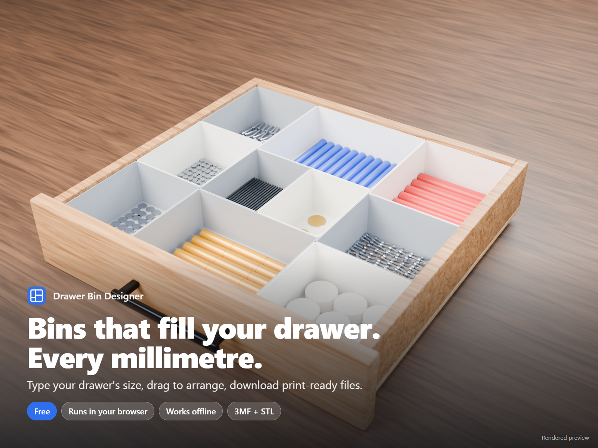
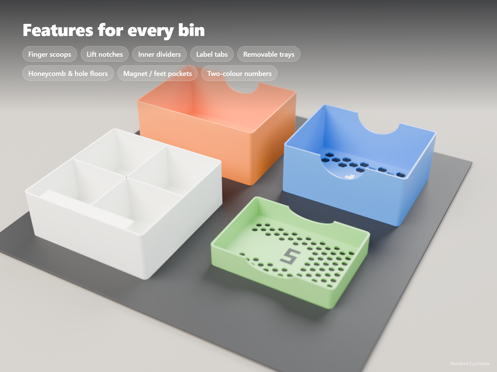
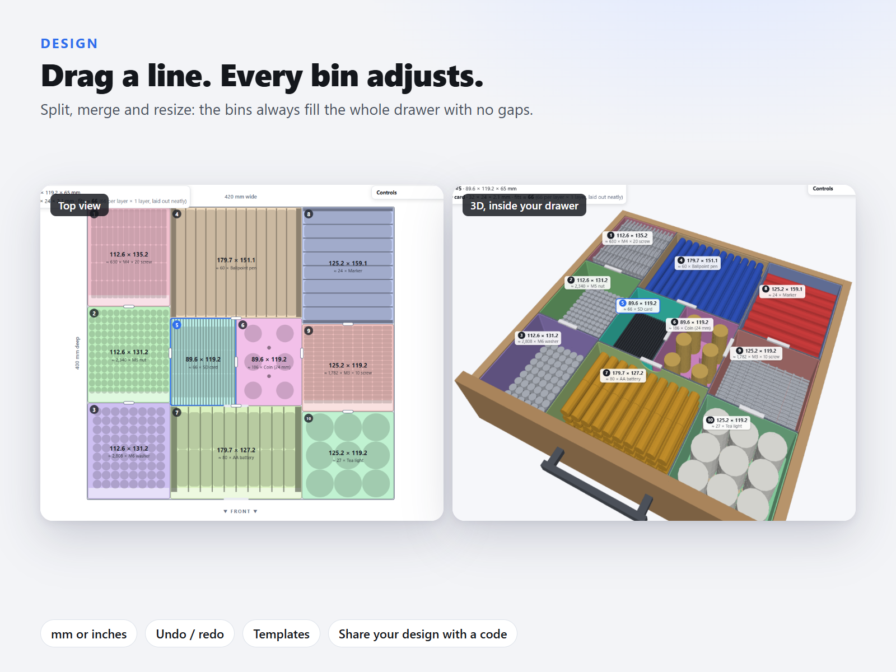
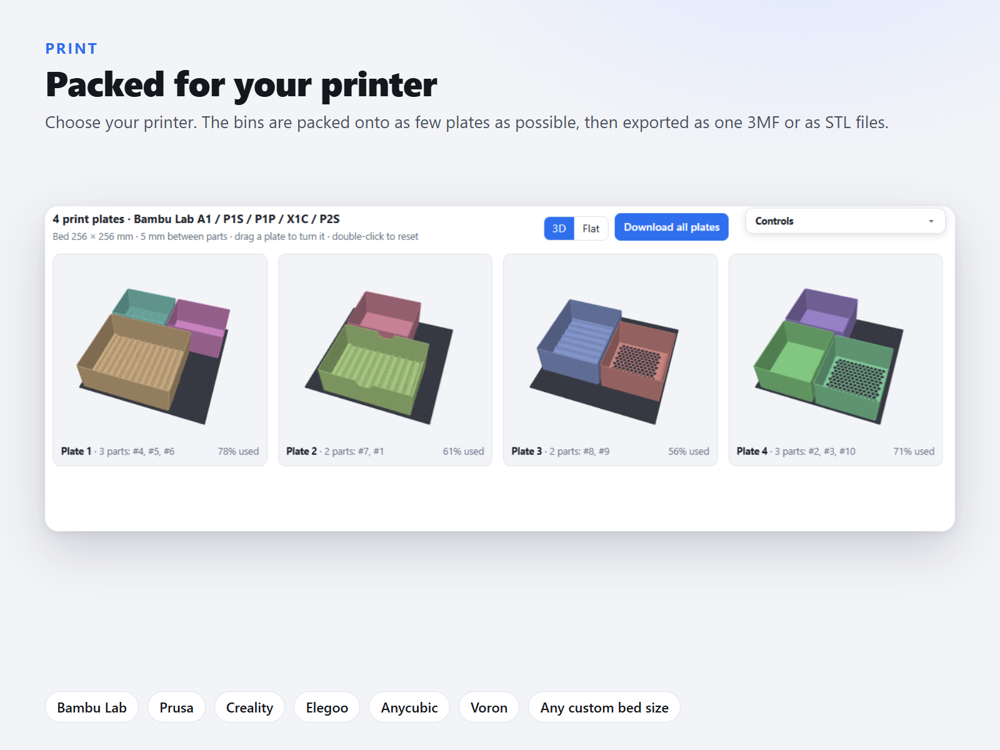

# Drawer Bin Designer

**Bins that fill your drawer. Every millimetre.**

A free tool that runs in your browser. Type your drawer's inside size, drag the lines to arrange the bins, and download print-ready 3MF or STL files.

### ▶ [Open the designer](https://eliyhoo.github.io/drawer-bin-designer/)

## What it does

- **Fills the drawer completely.** Drag any line and the neighbouring bins adjust, so there are never gaps.
- **Top view and 3D.** Edit in either one. Double-click a bin to see it on its own.
- **Features for every bin:** finger scoops, lift notches, inner dividers, label tabs, removable trays, honeycomb and other hole patterns in the floor, and pockets for magnets or rubber feet.
- **Engraved numbers** that match a printable layout picture, so every bin goes back in the right place. They can also be filled in a second colour (AMS).
- **Preview what fits:** screws, nuts, batteries, pens, cutlery, SD cards or your own item, with separators sized to them.
- **Packed for your printer:** pick your printer and the bins go onto as few plates as possible. Download one 3MF with all the plates, or STL files.
- **mm or inches, undo / redo, templates,** and design codes you can share.

## Demo

A one-minute walkthrough: [demo.mp4](images/demo.mp4)

## Offline version

[`drawer-bin-designer.html`](drawer-bin-designer.html) is the whole tool in one file. Download it and open it in any browser; it works without internet.

## Privacy

The website counts anonymous visits and downloads with [GoatCounter](https://www.goatcounter.com/). It uses no cookies and collects no personal data. The offline file sends nothing.

*The pictures of printed bins are renders.*
